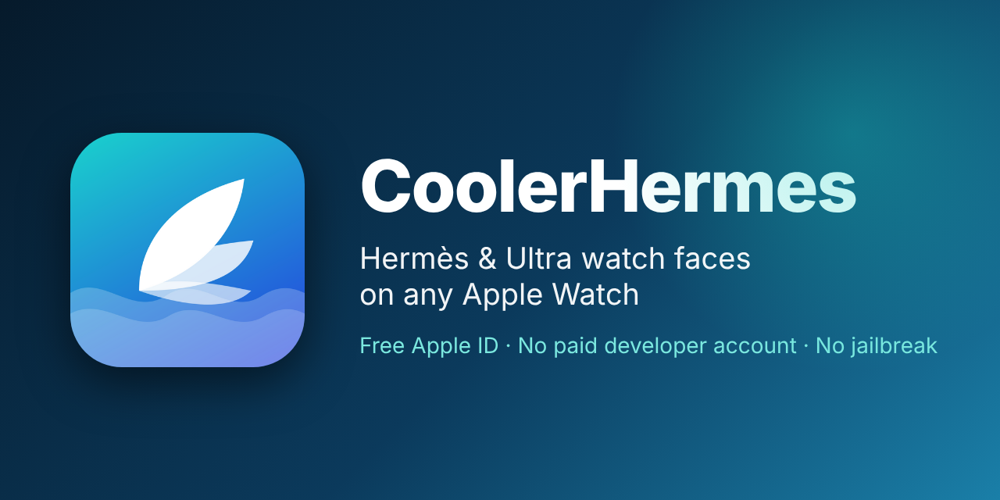

  

<h1 align="center">CoolerHermes</h1>

  <b>Hermès and Ultra watch faces on the Apple Watch you already own. 
  Works with a free Apple ID: no paid Apple Developer account, no jailbreak.</b>

  
  
  
  
  

## Why CoolerHermes

Installing a sideloaded app on an Apple Watch usually sends people to the paid Apple Developer Program ($99 a year). CoolerHermes does not need it. **You can unlock Hermès watch faces and Ultra watch faces without a paid Apple developer account**, using only a free Apple ID, and without jailbreaking your iPhone or Apple Watch.

If you searched for how to get Hermès watch faces on Apple Watch without a developer account, how to get Apple Watch Ultra faces on a regular Apple Watch for free, or an Apple Watch Hermès faces unlock that works with a free Apple ID, this is the project.

## What you get

- Hermès faces on any supported Apple Watch, with a free Apple ID
- Ultra faces on any supported Apple Watch, with a free Apple ID
- Siri AI for US-region setups
- A switch for each feature, so you only change what you want
- A backup saved before every change, with one-tap restore
- A raw key editor for anything the switches don't cover

## No paid Apple developer account

| | CoolerHermes | Typical sideloading route |
|---|---|---|
| Apple Developer Program ($99/year) | **Not needed** | Often required |
| Free Apple ID | **Enough** | Sometimes |
| Jailbreak | **Not needed** | Sometimes |
| Mac required | No (a Windows PC is enough for the watch install) | Often |

## How it works

1. Install CoolerHermes on your iPhone with a free Apple ID.
2. Install the small helper on your Apple Watch.
3. Open the app, link your watch, flip the faces you want.
4. Tap Apply. The watch reloads and the faces are there.

## Before you start

- iPhone running iOS or iPadOS 26 or newer
- An Apple Watch on a supported watchOS release
- Developer Mode turned on, on both devices
- Any sideloading tool that signs with a free Apple ID (no paid account)

## Setup guide

**iPhone**

Grab `CoolerHermes.ipa` from the [Releases page](https://github.com/Coolerwave/CoolerHermes/releases/latest), sign it with your sideloading tool using a free Apple ID, and install it. Then open Settings → General → VPN & Device Management and trust your certificate.

**Apple Watch**

The helper has to be trusted separately on the watch, so repeat the trust step there too. We use WatchBridge to push the iPhone app and the watch helper together, again with a free Apple ID. It's a community tool and not part of this project.

After that, open CoolerHermes, expand the device card at the top, connect your watch, and you're set.

## FAQ

**Do I need a paid Apple Developer account?**
No. A free Apple ID is enough.

**Do I need a jailbreak?**
No. Neither the iPhone nor the Apple Watch is jailbroken.

**Can I get Hermès watch faces on a normal Apple Watch for free?**
Yes, that is what CoolerHermes does. The app is free and open source.

**Can I get Ultra watch faces on a non-Ultra Apple Watch?**
Yes, on supported watchOS versions. Flip the Ultra card and press Apply.

**Can I undo it?**
Yes. A backup is saved before every change, and Restore is inside the app.

## Good to know

- Free Apple ID accounts allow a few sideloaded apps at once. If install fails with a limit error, remove one old app and retry.
- Apps signed with a free Apple ID expire after 7 days. Re-sign them with your sideloading tool to keep them running.
- The backup is made automatically. Restore it from inside the app before you ever delete CoolerHermes.
- CoolerHermes isn't affiliated with or endorsed by Apple or Hermès. You use it at your own risk.

## Credits and license

Built on [GestaltEdit](https://github.com/frs0n/GestaltEdit) and the open-source work behind it, modified (see git history). The idea of enabling Hermès faces comes from [HermesEnabler](https://github.com/pookjw/HermesEnabler) by pookjw. Full notices are in `LICENSE` and the bundled license files.

CoolerHermes is released under the [GNU General Public License v3.0 or later](LICENSE).

Keywords: Hermès watch faces, Apple Watch Ultra faces, unlock Hermès face, Apple Watch without paid developer account, free Apple ID sideload, no jailbreak, watchOS, MobileGestalt.
